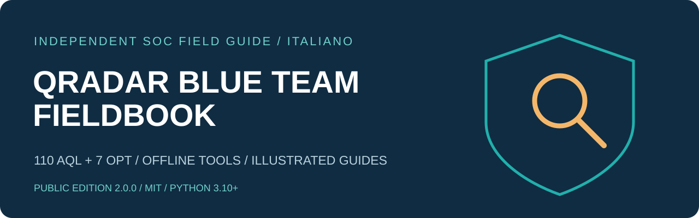

# QRadar Blue Team Fieldbook

117 template AQL. Evidenze prima delle ipotesi. Dal triage all’hunting approfondito.

Un fieldbook indipendente per IBM QRadar SIEM/Ariel, dedicato ad analisti SOC, incident responder e blue/purple team. Prepara query offline, interpreta i risultati e misura le prestazioni senza nascondere variazioni di copertura.

- 110 query principali + 7 varianti di ottimizzazione
- Strumenti Python offline senza dipendenze runtime
- Tre guide PDF illustrate e documentazione Markdown modificabile
- Parametri generici e indirizzi riservati alla documentazione
- Licenza MIT, modelli per contributi e controlli GitHub Actions

> Template confrontati con documentazione e controllati offline. Non sono stati analizzati dal parser né eseguiti sulla tua installazione QRadar. Campi DSM, build, permessi e retention richiedono validazione locale.

## Inizia in un minuto

```bash
python3 verify_package.py
python3 render_query.py --list
python3 render_query.py Q001 --params examples/params.ip.json --output work/Q001.aql
```

```powershell
py -3 -X utf8 render_query.py Q001 --params examples/params.ip.json --output work/Q001.aql
```


## Documentazione

| Guida | Markdown | PDF |
|---|---|---|
| Manuale completo | [manual.md](docs/manual.md) | [PDF](docs/pdf/field-manual.pdf) |
| Query avanzate e prestazioni | [advanced](docs/advanced-guide.md) / [performance](docs/performance.md) | [PDF](docs/pdf/advanced-performance.pdf) |
| Uso e pubblicazione | [start](docs/getting-started.md) / [GitHub](docs/publishing.md) | [PDF](docs/pdf/getting-started.pdf) |

[Query index](docs/query-index.md) / [File map](docs/file-map.md) / [Properties](docs/custom-properties.md) / [Sources](docs/sources.md)

## Struttura del repository

| Path | Uso |
|---|---|
| queries/*.aql | 117 template testuali separati, non un formato di importazione massiva QRadar. |
| queries.json / variants.json | Cataloghi canonici usati dal renderer e dalla documentazione generata. |
| parameter_schema.json | Tipi dei parametri ed esempi sintetici, non configurazione QRadar. |
| params.example.json / examples/ | Modello vuoto e piccoli input dimostrativi con indirizzi di documentazione. |
| fieldbook.py / render_query.py | Validazione e preparazione locali; nessuna connessione o esecuzione AQL. |
| verify_package.py / MANIFEST.sha256.json | Coerenza cataloghi/file e integrità della release. |
| docs/*.md / docs/pdf/ | Manuale, atlante, guide uso/prestazioni modificabili e tre PDF pronti. |
| docs/assets/ | Identità grafica vettoriale e diagrammi concettuali originali. |
| tests/ / .github/workflows/ | Test offline e workflow CI fornito. |
| tools/build_docs.py / tools/release.py | Ricostruzione AQL/Markdown/PDF e aggiornamento esplicito del manifest. |
| requirements-docs.txt | Dipendenza opzionale bloccata per i PDF; non serve agli strumenti runtime. |
| LICENSE / NOTICE / CONTRIBUTING.md | Licenza MIT, attribuzioni, limiti di validazione e politica dei contributi. |

## Limiti della validazione

```bash
python3 -m unittest discover -s tests -v
```

Template confrontati con documentazione e controllati offline. Non sono stati analizzati dal parser né eseguiti sulla tua installazione QRadar. Campi DSM, build, permessi e retention richiedono validazione locale.

## Pubblicare il repository

[GitHub: procedura completa](docs/publishing.md)

## Licenza e attribuzioni

[MIT](LICENSE) / [Notice](NOTICE.md) / [Contributing](CONTRIBUTING.md) / [Security](SECURITY.md)

Version 2.0.0 / 2026-11-04.

[Validation record](VALIDATION.md) / [GitHub metadata](docs/github-metadata.md)
