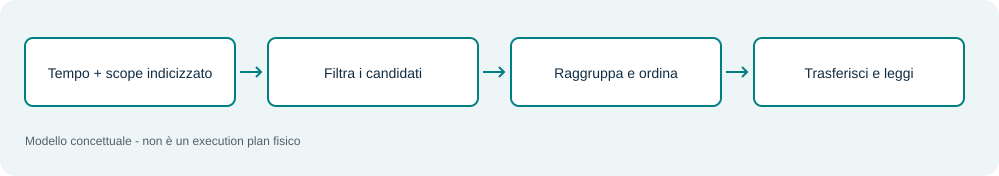
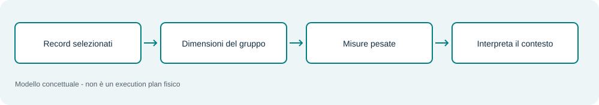
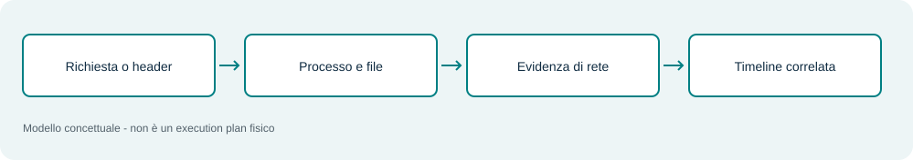
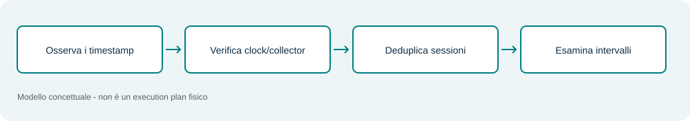
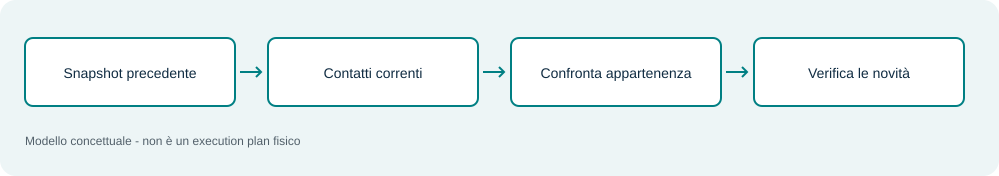
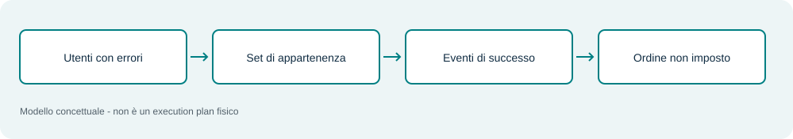

# Query avanzate e prestazioni

Template confrontati con documentazione e controllati offline. Non sono stati analizzati dal parser né eseguiti sulla tua installazione QRadar. Campi DSM, build, permessi e retention richiedono validazione locale.

## D01 / Q005 - La finestra della offense



INOFFENSE seleziona l’associazione alla offense; TIMES OFFENSE_TIME limita ai tempi applicabili. Sono due condizioni distinte. Per confronto usa anche una finestra assoluta che includa la stessa attività.

```sql
SELECT starttime, sourceip, destinationip, username,
       QIDNAME(qid) AS Evento, UTF8(payload) AS Raw
FROM events
WHERE INOFFENSE(<OFFENSE_ID>)
TIMES OFFENSE_TIME(<OFFENSE_ID>)
```

**Limiti e falsi positivi:** Una offense può essere aggiornata mentre lavori. Per il confronto salva stato e tempi, verifica retention e conta i risultati su entrambe le varianti.

**Ridurre il lavoro di ricerca:** Confronta con Q004 sullo stesso insieme temporale. OFFENSE_TIME restringe i tempi applicabili; verifica risultati e build prima di affidargli ricerche salvate.

## D02 / Q017 - Spray e coalescenza



UNIQUECOUNT misura l’ampiezza degli utenti; SUM(eventcount) pesa le righe coalescenti. Il filtro sulla sorgente Windows e su 4625 precede logicamente il raggruppamento. Le soglie del manuale sono illustrative.

```sql
SELECT sourceip, UNIQUECOUNT("Hunt_TargetUser") AS Utenti,
       SUM(eventcount) AS Errori
FROM events
WHERE logsourceid = <LS_WIN>
  AND "Hunt_EventID" = '4625'
GROUP BY sourceip
HAVING Utenti >= 10 AND Errori >= 20
ORDER BY Errori DESC
LAST 15 MINUTES
```

**Limiti e falsi positivi:** Nel campione: tre righe, dodici errori, tre utenti. Non supera le soglie Q017 del manuale. NAT, proxy e servizi concentrano più utenti dietro una sola origine.

**Ridurre il lavoro di ricerca:** Limita alle fonti Security/DC pertinenti e alla finestra utile. Filtra EventID prima dell’aggregazione; non aggiungere username singolo se vuoi misurare uno spray su molti utenti.

## D03 / Q038 - Egress e rapporto dei byte



SUM aggrega per coppia/porta. HAVING applica volume e rapporto dopo l’aggregazione: non seleziona soltanto i singoli record grandi. Prima verifica che source sia effettivamente l’host che stai studiando.

```sql
SELECT sourceip, destinationip, destinationport,
       SUM(sourcebytes) AS OutB,
       SUM(destinationbytes) AS InB
FROM flows
WHERE sourceip = '<HOST>'
GROUP BY sourceip, destinationip, destinationport
HAVING OutB > 100000000 AND OutB > 10 * InB
ORDER BY OutB DESC
LAST 60 MINUTES
```

**Limiti e falsi positivi:** Backup e replica possono soddisfare il criterio. Sampling, segmenti flow e orientamento richiedono verifica; il contenuto cifrato non è ricavato dai byte.

**Ridurre il lavoro di ricerca:** Se conosci l’host, mantieni il filtro sourceip. Somma i byte prima di chiedere raw/PCAP. Cambiare soglie o intervallo modifica ciò che viene segnalato.

## D04 / Q040 - Il falso beacon perfetto



Q039 propone coppie da approfondire usando frequenza e dimensione. Q040 restituisce timestamp per analisi degli intervalli. Non esiste in queste query una misura AQL della periodicità.

```sql
SELECT firstpackettime, lastpackettime,
       sourceip, destinationip, destinationport,
       sourcebytes, destinationbytes
FROM flows
WHERE sourceip = '<HOST>' AND destinationip = '<DST>'
ORDER BY firstpackettime ASC
LIMIT 1000 LAST 60 MINUTES
```

**Limiti e falsi positivi:** Scheduler legittimi e heartbeat sono spesso periodici. Non usare STDEV(sourcebytes) come se fosse deviazione standard degli intervalli temporali.

**Ridurre il lavoro di ricerca:** Esporta soltanto la coppia e i timestamp necessari; estendi il limite se troncava la serie. Confronta sessioni deduplicate, non singoli segmenti di flow.

## D05 / Q066 - Bucket temporali senza ambiguità


starttime è epoch in millisecondi. Dividere per 300000, convertire a LONG e moltiplicare riporta ogni evento all’inizio del bucket. È una chiave numerica; la data leggibile viene dopo.

```sql
SELECT LONG(starttime / 300000) * 300000 AS BucketMs,
       SUM(eventcount) AS Eventi
FROM events
WHERE logsourceid = <LS_ID>
GROUP BY BucketMs
ORDER BY BucketMs ASC
LAST 60 MINUTES
```

**Limiti e falsi positivi:** L’assenza di un bucket non è zero misurato: può essere mancanza di dati. Coalescenza e clock influenzano l’allocazione dei conteggi.

**Ridurre il lavoro di ricerca:** Mantieni il confronto temporale nativo nel motore; formatta il bucket solo nell’output. Ridurre da 5 a 1 minuto aumenta il numero di gruppi e cambia la risoluzione.

## D06 / Q067 - Ritardo o orologio sbagliato?


La differenza storageTime - devicetime è un delta osservato. Include buffering, trasporto, processamento e disallineamento dei clock. Il divisore 1000.0 esprime il valore in secondi.

```sql
SELECT logsourceid,
       AVG((storageTime-devicetime)/1000.0) AS MediaSec,
       MAX((storageTime-devicetime)/1000.0) AS MaxSec
FROM events
WHERE logsourceid = <LS_ID> AND devicetime > 0
GROUP BY logsourceid
LAST 60 MINUTES
```

**Limiti e falsi positivi:** Non presentare il delta come latenza di rete. Per latenza pura servono misure coerenti delle fasi; un parsing della timezone errato può dominare il risultato.

**Ridurre il lavoro di ricerca:** Interroga una sorgente alla volta quando cerchi il ritardo di quella sorgente; estrai pochi raw solo dopo l’aggregazione e verifica i clock.

## D07 / Q071 - Relazione user-host



Un set seleziona gli account tecnici. Una map of sets collega ogni account ai suoi IP consentiti. La query restituisce la relazione assente nella mappa dopo i filtri sul logon.

```sql
SELECT starttime, username, sourceip,
       QIDNAME(qid) AS Evento
FROM events
WHERE logsourceid = <LS_WIN>
  AND "Hunt_EventID" = '4624'
  AND REFERENCESETCONTAINS('Hunt_ServiceUsers',username)
  AND NOT REFERENCEMAPSETCONTAINS(
      'Hunt_UserAllowedIPs',username,sourceip)
LIMIT 200 LAST 60 MINUTES
```

**Limiti e falsi positivi:** Il valore username deve riferirsi al soggetto corretto. DHCP, NAT e account condivisi possono rendere la baseline incompleta; set e mappe sono stato corrente.

**Ridurre il lavoro di ricerca:** Metti la relazione user-IP dopo un perimetro selettivo di eventi. La mappa deve essere completa; un set troppo ampio non è una scorciatoia equivalente.

## D08 / Q072 - La sottoquery non è una sequenza



La query interna produce l’insieme degli utenti con 4625. L’esterna cerca 4624 che appartengono a quell’insieme. La finestra esterna è più ampia: può includere un successo precedente al fallimento.

```sql
SELECT starttime, sourceip, "Hunt_TargetUser",
       UTF8(payload) AS Raw
FROM events
WHERE logsourceid = <LS_WIN>
  AND "Hunt_EventID" = '4624'
  AND "Hunt_TargetUser" IN (
    SELECT "Hunt_TargetUser" FROM events
    WHERE logsourceid = <LS_WIN>
      AND "Hunt_EventID" = '4625'
    GROUP BY "Hunt_TargetUser"
    LIMIT 10000 LAST 15 MINUTES)
LIMIT 200 LAST 60 MINUTES
```

**Limiti e falsi positivi:** Per prima errore poi successo, stesso IP e stesso host, ricostruisci gli eventi o usa correlazione CRE stateful. IN non implementa queste condizioni.

**Ridurre il lavoro di ricerca:** Valuta separatamente la subquery: sorgente, EventID, finestra e cardinalità utenti. Un LIMIT interno più basso può togliere candidati; preferisci suddividere un set completo e disgiunto.

## D09 / Q074 - Baseline precedente alla ricerca


La query esclude le destinazioni presenti nel set baseline e conta le rimanenti. Il set deve rappresentare il periodo precedente, non includere già i contatti sospetti appena osservati.

```sql
SELECT destinationip, destinationport,
       COUNT(*) AS Righe
FROM flows
WHERE sourceip = '<HOST>'
  AND NOT REFERENCESETCONTAINS('Hunt_BaselineDestIP',
                              destinationip)
GROUP BY destinationip, destinationport
ORDER BY Righe DESC
LAST 60 MINUTES
```

**Limiti e falsi positivi:** First seen significa primo rispetto al dataset disponibile. Indirizzi CDN cambiano: una novità può essere operativa; una baseline contaminata può includere attività ostile.

**Ridurre il lavoro di ricerca:** Conserva il filtro dell’host e lo snapshot baseline precedente. Non velocizzare aggiornando il set con i contatti della finestra corrente: li nasconderesti.

## D10 / Q075 - Due contatori con CASE


CASE assegna eventcount al contatore pertinente e zero negli altri casi. SUM combina i pesi per sourceip. Non usa due ricerche con finestre potenzialmente diverse.

```sql
SELECT sourceip,
       SUM(CASE WHEN "Hunt_Action" = 'deny'
                THEN eventcount ELSE 0 END) AS Deny,
       SUM(CASE WHEN "Hunt_Action" = 'allow'
                THEN eventcount ELSE 0 END) AS AllowN
FROM events
WHERE logsourceid = <LS_FW>
GROUP BY sourceip
ORDER BY Deny DESC
LIMIT 50 LAST 60 MINUTES
```

**Limiti e falsi positivi:** Nel campione i contatori sommano 13 su 15 eventi rappresentati: altri esiti sono esclusi. Un deny alto non significa che tutti i tentativi siano stati bloccati.

**Ridurre il lavoro di ricerca:** Filtra sorgente e finestra prima dei contatori. Rimuovi l’ordinamento solo se basta una tabella non classificata; gli esiti diversi da allow/deny restano fuori.

## D11 / Q076 - FROM o HAVING?


L’interno aggrega destinazioni per sorgente e produce N. Il filtro esterno N >= 30 legge il cursore. Per questo esempio una singola query con HAVING può esprimere la stessa domanda.

```sql
SELECT sourceip, N
FROM (
  SELECT sourceip, UNIQUECOUNT(destinationip) AS N
  FROM events
  WHERE logsourceid = <LS_FW>
  GROUP BY sourceip
  LAST 15 MINUTES)
WHERE N >= 30
ORDER BY N DESC
```

**Limiti e falsi positivi:** Non estendere la semplificazione a sottoquery che cambiano davvero schema o aggregazione. FROM non è una JOIN tra events e flows.

**Ridurre il lavoro di ricerca:** Per questo caso usa HAVING sul gruppo e togli il livello esterno se il risultato è equivalente. La sottoquery FROM non rende automaticamente la ricerca più rapida.

## D12 / Q077 - GLOBALVIEW e dati accumulati


La vista contiene aggregati già preparati da una saved search configurata per accumulare. La ricerca legge quelle colonne e quei periodi; non ricostruisce automaticamente il raw.

```sql
SELECT *
FROM GLOBALVIEW('<SAVED_SEARCH>','NORMAL')
LIMIT 20 LAST 24 HOURS
```

**Limiti e falsi positivi:** La vista non equivale agli eventi originali. Se serve conferma di un comando o di un header, torna ai log pertinenti e verifica la retention.

**Ridurre il lavoro di ricerca:** Verifica nome/schema della vista e usa il percorso API documentato. Seleziona le sole colonne necessarie; una vista senza raw non sostituisce l’indagine di dettaglio.

## D13 / Q085 - Co-occorrenza SMTP ed esecuzione


La query richiede header e almeno un marker di comando nello stesso record. È un filtro didattico generico, non un exploit divulgato per una appliance.

```sql
SELECT starttime, sourceip, destinationip, username,
       QIDNAME(qid) AS Evento, UTF8(payload) AS Raw
FROM events
WHERE logsourceid = <LS_MAIL>
  AND (UTF8(payload) ILIKE '%Message-ID:%'
       AND (UTF8(payload) ILIKE '%TO PROGRAM%'
            OR UTF8(payload) ILIKE '%<EXEC_MARKER>%'))
ORDER BY starttime ASC
LIMIT 200 LAST 60 MINUTES
```

**Limiti e falsi positivi:** Se i frammenti sono separati in record diversi la relazione può sfuggire. Servono evidenze indipendenti di processi, file e rete per stabilire impatto.

**Ridurre il lavoro di ricerca:** Mantieni fonte e finestra motivate; usa dettagli sui soli candidati. La riduzione dello scope deve essere documentata e non garantisce equivalenza dei risultati.
